

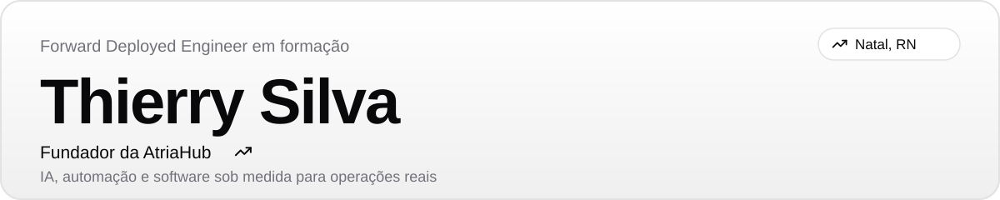

 

**Eu pego um trabalho manual e cheio de regra dentro de uma empresa e o transformo em operação com IA, automação e software sob medida.**
O que combino com o cliente é o **resultado**, e não horas.

 

  

<table>
<tr>
<td>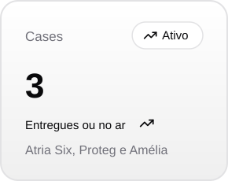</td>
<td>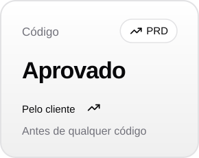</td>
<td>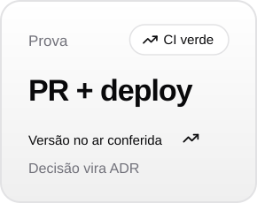</td>
<td>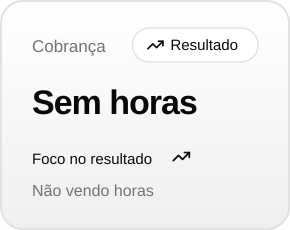</td>
</tr>
</table>

 

## O que eu faço

- **Agentes de IA e automação** para tarefas repetitivas, com humano aprovando o que é irreversível.
- **Sistemas sob medida:** SaaS, CRMs, portais e dashboards.
- **Tráfego pago (Meta Ads e Google Ads)** para PMEs regionais, o que me mantém perto de quem executa o trabalho.

 

## Como eu trabalho

<table>
<tr>
<td>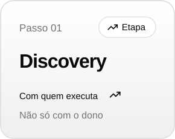</td>
<td>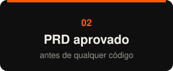</td>
<td>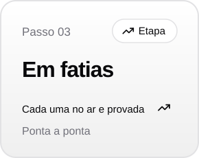</td>
<td>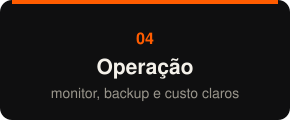</td>
</tr>
</table>

Cada tarefa fecha com prova: PR mergeado, CI e deploy verdes e a versão no ar conferida. Decisão importante vira registro (ADR), não fica só em conversa.

 

## Cases

<table>
<tr>
<td width="50%">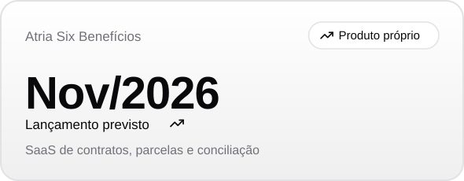</td>
<td width="50%">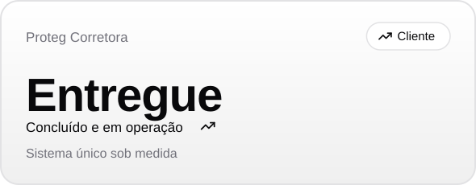</td>
</tr>
<tr>
<td width="50%">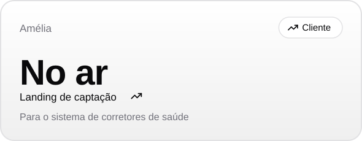</td>
<td width="50%">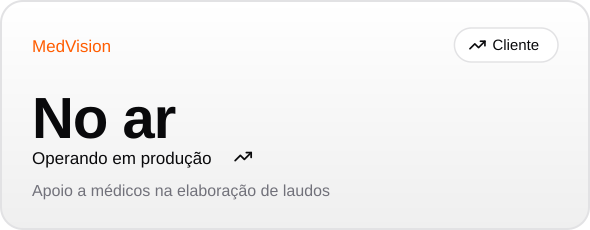</td>
</tr>
<tr>
<td width="50%">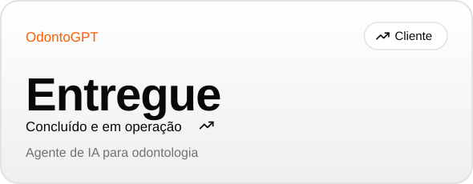</td>
<td width="50%">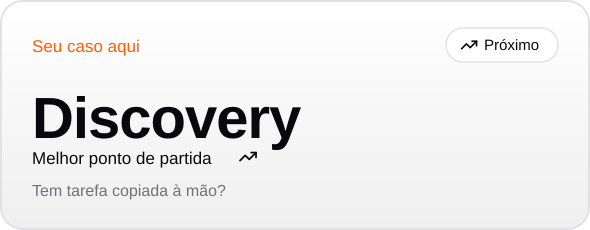</td>
</tr>
</table>

O código de produto e de clientes está em repositórios privados.

- **Atria Six Benefícios:** SaaS para corretoras de planos de saúde, com contratos, parcelas e conciliação financeira. Lançamento previsto para nov/2026.
- **Proteg Corretora:** sistema sob medida para uma corretora de benefícios de saúde, concluído e em operação.
- **Amélia:** landing page de captação do sistema de corretores de saúde, ligada ao ecossistema Atria Six.
- **MedVision:** sistema que ajuda profissionais da medicina a elaborar laudos, no ar.
- **OdontoGPT:** plataforma com IA para estudantes de odontologia, calibrada com livros e artigos científicos. Ajuda com simulados de provas e concursos e tira dúvidas das disciplinas da faculdade.

 

## Stack

 

## Vamos conversar

Tem uma tarefa na sua operação que alguém faz copiando dado de um lugar para outro? É o melhor ponto de partida.
